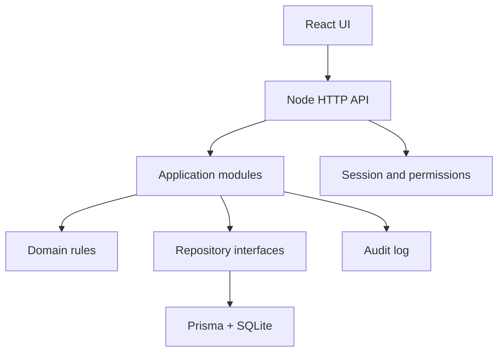
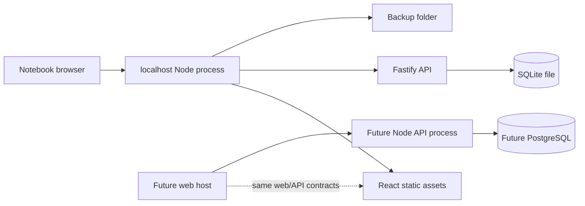

# Architecture Spine — StudioByNani

## Design Paradigm

StudioByNani será un **monolito modular**: una aplicación Node contiene la API, las reglas de dominio y el servidor de producción del frontend React. El sistema se ejecuta inicialmente en la notebook del estudio y conserva una frontera HTTP clara para poder desplegarse posteriormente en un servidor web.

Los módulos de dominio son:

- Identidad y permisos.
- Empleadas y catálogo.
- Atenciones.
- Precios, descuentos, comisiones y liquidación.
- Gastos y cierres diarios.
- Reportes.

## Invariants & Rules

### AD-1 — La API es dueña del estado

- **Binds:** FR-4..FR-23, UJ-1..UJ-4
- **Prevents:** Cálculos distintos entre pantallas, escrituras directas desde el navegador y reglas que puedan evadirse modificando JavaScript.
- **Rule:** React solo consulta la API. Node valida, calcula y persiste toda mutación. Ningún módulo frontend accede directamente a SQLite.

### AD-2 — Modular monolith antes que servicios distribuidos

- **Binds:** all
- **Prevents:** Complejidad operativa innecesaria para una única notebook y divergencia entre servicios pequeños.
- **Rule:** Todos los módulos se despliegan como un único proceso Node. Los límites son módulos internos y contratos de API; no se crean microservicios en el MVP.

### AD-3 — El dominio financiero se calcula en servidor

- **Binds:** FR-8..FR-12, FR-17..FR-19, FR-21
- **Prevents:** Manipulación o redondeos inconsistentes de precios, descuentos, comisiones y entregas a NANI.
- **Rule:** El servidor calcula y guarda precio aplicado, precio final, comisión y entrega a NANI como valores derivados de la atención. El frontend solo presenta resultados.

### AD-4 — Las atenciones son históricas e inmutables por eliminación

- **Binds:** FR-6..FR-8, FR-18
- **Prevents:** Pérdida de trazabilidad y alteración silenciosa de reportes.
- **Rule:** Una atención nunca se elimina. La empleada puede editar sus propias atenciones hasta 24 horas; NANI puede corregirlas fuera de esa ventana. Toda edición actualiza `updatedAt` y deja registro de auditoría.

### AD-5 — El precio aplicado queda congelado

- **Binds:** FR-8..FR-11, FR-13
- **Prevents:** Que cambiar el catálogo modifique históricos.
- **Rule:** Cada atención conserva precio base, descuento, precio final y regla aplicada al momento de guardar. El catálogo solo afecta nuevas atenciones.

### AD-6 — El cierre diario es una operación explícita

- **Binds:** FR-17..FR-19, UJ-2
- **Prevents:** Cambios silenciosos en un día ya conciliado.
- **Rule:** El cierre tiene estado `open` o `closed`; solo NANI puede reabrirlo, debe registrar motivo y toda reapertura queda auditada.

### AD-7 — La persona que realiza la atención recibe el pago

- **Binds:** FR-12, FR-17..FR-19
- **Prevents:** Modelar un receptor separado que contradiga la operación real del estudio.
- **Rule:** La atención queda asociada a la empleada que la realiza. El sistema calcula la entrega al negocio sobre el precio final: LULA 30%, LOLA 40%, LEDIS 30%; NANI conserva 100% de sus atenciones.

### AD-8 — Persistencia local portable

- **Binds:** FR-4..FR-23, deployment inicial
- **Prevents:** Dependencia de un servidor externo para operar en la notebook y bloqueo de una futura publicación web.
- **Rule:** El MVP usa SQLite en un archivo administrado por Node. La capa de acceso a datos no expone SQLite fuera del módulo de persistencia y debe permitir una migración posterior a PostgreSQL.

### AD-9 — La autenticación simple conserva separación de roles

- **Binds:** FR-1..FR-3
- **Prevents:** Acceso como otra persona seleccionando solamente un nombre y autorización basada en controles visuales.
- **Rule:** El acceso usa selector de usuario más PIN corto. Node crea la sesión y aplica permisos en cada endpoint; el frontend no decide autorizaciones.

### AD-10 — El tiempo oficial lo genera el servidor

- **Binds:** FR-4, FR-6, FR-8, FR-18
- **Prevents:** Fechas manipuladas desde el navegador y ventanas de edición inconsistentes.
- **Rule:** `createdAt`, `updatedAt`, fecha de atención y eventos de auditoría se generan en Node usando la zona horaria configurada del estudio.

### AD-11 — Los backups son parte del funcionamiento local

- **Binds:** deployment inicial, integridad de datos
- **Prevents:** Pérdida total del historial por falla de notebook o archivo SQLite corrupto.
- **Rule:** La aplicación debe ofrecer backup manual y permitir una tarea periódica que copie el archivo SQLite a una ubicación configurable, conservando múltiples versiones.

### AD-12 — Un único motor calcula la liquidación

- **Binds:** FR-5, FR-8..FR-12, FR-17..FR-19, FR-21
- **Prevents:** Que atenciones, cierres y reportes calculen comisiones, descuentos o entregas con fórmulas distintas.
- **Rule:** `SettlementService` es la única fuente de precio final, comisión y entrega a NANI. Solo las atenciones `realizada` generan importe; `cancelada` y `ausente` generan importe, comisión y entrega iguales a cero. El servicio redondea en centavos y devuelve una versión de regla.

### AD-13 — El tiempo de negocio es centralizado

- **Binds:** FR-4, FR-6, FR-8, FR-17..FR-19
- **Prevents:** Fechas locales inconsistentes, ventanas de edición distintas y cierres con días diferentes.
- **Rule:** Node genera instantes en UTC mediante un `Clock` central. El sistema usa una zona IANA configurable, inicialmente `America/Argentina/Buenos_Aires`, para calcular `businessDate`. La ventana de edición termina exactamente en `createdAt + 24 horas`.

### AD-14 — El cierre es un snapshot bloqueante

- **Binds:** FR-17..FR-19, UJ-2
- **Prevents:** Totales diferentes entre el cierre, los reportes y nuevas cargas posteriores.
- **Rule:** Confirmar un cierre crea un snapshot de totales y bloquea nuevas mutaciones con ese `businessDate`. NANI debe reabrirlo con un motivo para permitir cambios; luego el sistema recalcula y registra una nueva versión del cierre.

### AD-15 — Cada entidad tiene un único propietario

- **Binds:** all
- **Prevents:** Módulos que sobrescriben atenciones, precios, liquidaciones o cierres sin coordinación.
- **Rule:** `Attendance` pertenece a Atenciones; `Service`, `Price` y habilitaciones pertenecen a Catálogo; `SettlementSnapshot` pertenece a Liquidación; `Expense` y `DailyClose` pertenecen a Cierres. Otros módulos solo acceden mediante casos de uso y repositorios contratados.

### AD-16 — Los contratos HTTP son compartidos y versionados

- **Binds:** FR-1..FR-23, apps/web, apps/api
- **Prevents:** Frontend y backend interpretando campos, errores o permisos de manera incompatible.
- **Rule:** La API pública inicia en `/api/v1`. Los esquemas de request/response viven en `packages/contracts`, se validan en Node y se consumen tipados desde React. Las mutaciones críticas deben ser idempotentes.

### AD-17 — La operación local es recuperable

- **Binds:** deployment inicial, integridad y disponibilidad
- **Prevents:** Copias inconsistentes, pérdida de datos y ausencia de diagnóstico en la notebook.
- **Rule:** El backup se realiza mediante una operación consistente de SQLite al confirmar el cierre, conserva copias rotativas configurables y expone una verificación de salud local. La restauración se prueba manualmente antes de una entrega estable.

### Dependency direction



## Consistency Conventions

| Concern | Convention |
|---|---|
| Naming | TypeScript en `camelCase`; entidades y tablas en singular lógico; rutas HTTP en plural kebab-case; IDs opacos generados por servidor. |
| Data & formats | JSON sobre HTTP; fechas ISO 8601; instantes UTC + `businessDate`; importes monetarios como enteros en centavos, nunca `float`. |
| API errors | Respuesta consistente `{ error: { code, message, fields? } }`; validación de entrada en el servidor; API versionada. |
| State & mutation | Todas las mutaciones pasan por casos de uso del backend; transacciones para guardar atención, calcular derivados y registrar auditoría. |
| Auth | Sesión local HttpOnly; permisos verificados en backend; no confiar en rol enviado por el navegador. |
| Audit | Registrar creación, edición, reapertura de cierre, cambios de catálogo y cambios de permisos. |
| Testing | Reglas financieras con pruebas unitarias; flujos principales con pruebas de API y browser. |
| Configuration | Variables de entorno para puerto, ruta de SQLite, zona horaria, carpeta de backups y retención; no guardar secretos en el repositorio. |
| Operations | `npm` workspaces + `package-lock.json`; un proceso local Node en desarrollo y producción; logs estructurados y endpoint de salud local. |

## Stack

| Name | Version |
|---|---|
| Node.js | 24.20 LTS |
| TypeScript | 5.9+ |
| React | 19.3.0 |
| Vite | 8.3.0 |
| Fastify | 5.12.5 |
| Prisma ORM | 7.10.0 |
| SQLite | 3.x, archivo local |
| Package manager | npm 11.x + npm workspaces |
| Testing | Vitest + Playwright, versions pinned in package lock |

## Structural Seed

```text
/
  apps/
    web/                 # React + Vite; presentation and API client only
    api/                 # Node + Fastify; HTTP composition and auth
  packages/
    domain/              # Rules and types shared by backend tests
    contracts/           # API schemas and DTOs
  prisma/
    schema.prisma        # SQLite schema and migrations
  tests/
    api/                 # API and financial rule tests
    e2e/                 # Main employee and NANI journeys
  data/
    studiobynani.sqlite  # Local runtime data, ignored by git
    backups/             # Rotating local backups, ignored by git
```



## Capability → Architecture Map

| Capability / Area | Lives in | Governed by |
|---|---|---|
| FR-1..FR-3 Access and roles | `apps/api/auth`, `apps/web/access` | AD-1, AD-9 |
| FR-4..FR-7 Atenciones | `packages/domain/attendances`, `apps/api/attendances` | AD-1, AD-4, AD-10 |
| FR-5 States | `packages/domain/attendances` | AD-1, AD-12 |
| FR-8..FR-12 Financial rules | `packages/domain/settlement` | AD-3, AD-5, AD-12 |
| FR-13..FR-15 Catalog and staff | `apps/api/catalog`, `apps/api/staff` | AD-5, AD-9 |
| FR-16..FR-19 Expenses and closing | `packages/domain/closing`, `apps/api/closing` | AD-3, AD-6, AD-11 |
| FR-20..FR-23 Reports | `apps/api/reports`, `apps/web/reports` | AD-1, AD-3 |
| UJ-1..UJ-4 Main journeys | `apps/web/pages`, `apps/api` | AD-1, AD-2 |

## Deferred

- Cloud hosting and remote database: deferred until local operation is stable.
- TuTurno API integration and import of email/phone: deferred until API access and data mapping are available.
- Multi-device concurrent access: deferred; the MVP runs on one notebook.
- Advanced authentication, password recovery and external identity providers: deferred; local PIN is sufficient for MVP.
- PostgreSQL migration: deferred until remote deployment is needed; repository boundaries must remain compatible.
- Offline synchronization and conflict resolution: deferred because the MVP uses one local runtime.
